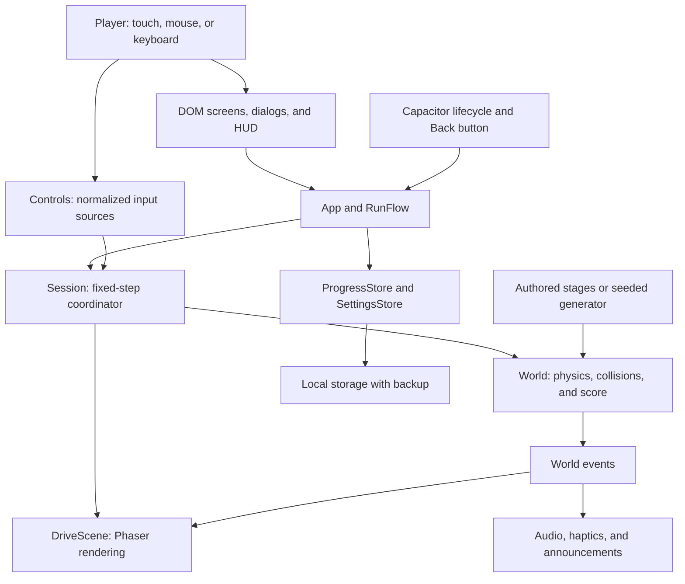
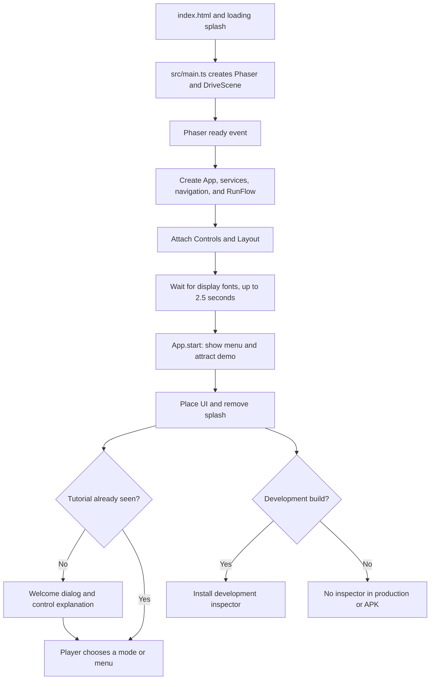
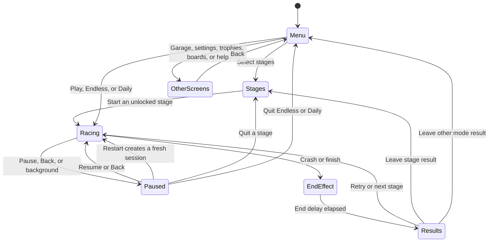
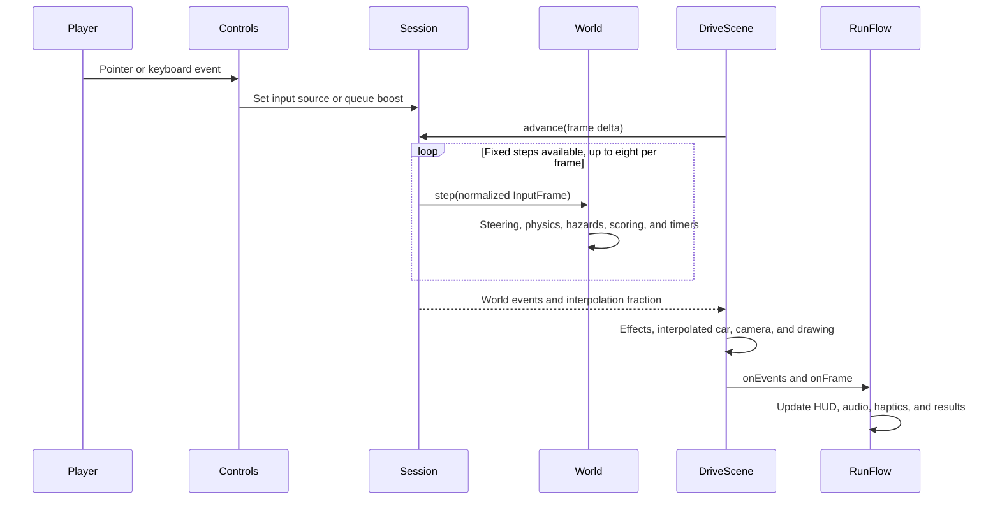
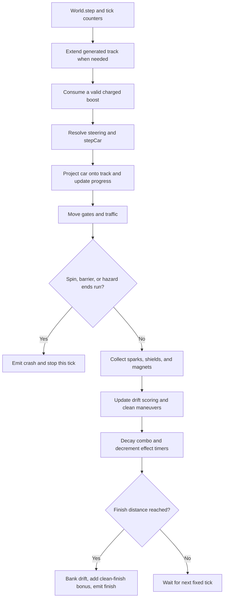
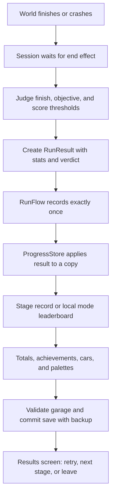
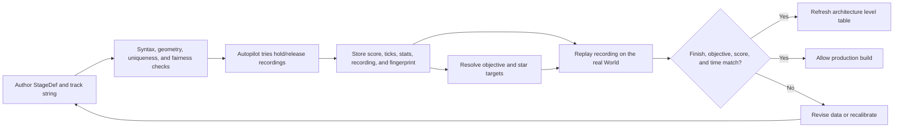
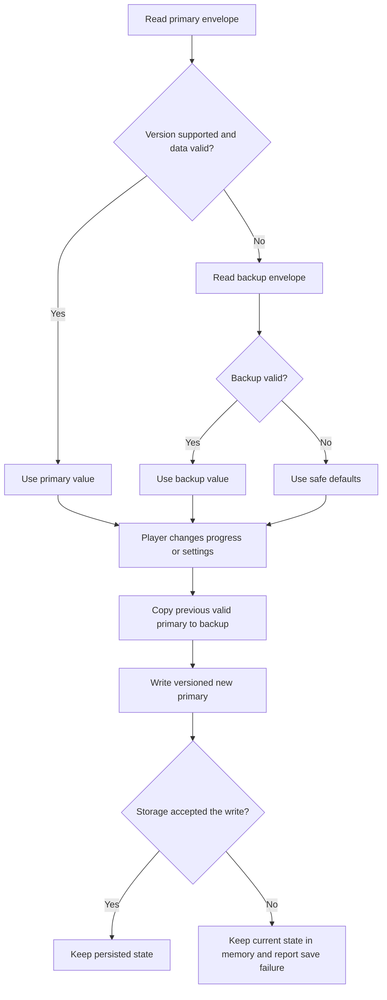
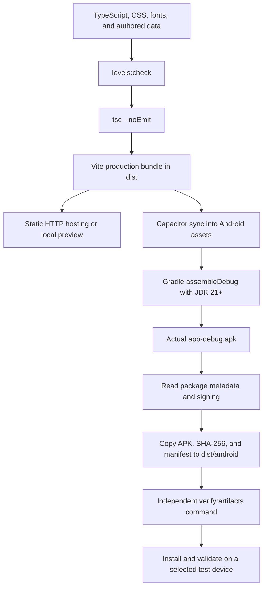

# Neon Drift architecture

This guide describes the implemented Neon Drift v1.0 codebase, including its boundaries and current verification
limits. Start with [README.md](README.md) to install and play. Flowcharts use Mermaid and render in GitHub and
other Markdown viewers with Mermaid support.

## Reading map

- [System overview](#system-overview): the main pieces and why they are separated.
- [Startup and navigation](#startup-and-navigation): from loading the page to starting an attempt.
- [Input, simulation, and rendering](#input-simulation-and-rendering): what happens on every frame.
- [Collisions, scoring, and results](#collisions-scoring-and-results): how an attempt becomes saved progress.
- [Level authoring and generated modes](#level-authoring-and-generated-modes): stage data, validation, and seeds.
- [Persistence and platform services](#persistence-and-platform-services): saves, audio, haptics, and lifecycle.
- [Build and distribution](#build-and-distribution): the shared web/Android delivery pipeline.
- [Working on the codebase](#working-on-the-codebase): where to make changes and which checks to run.
- [Verification and release status](#verification-and-release-status): measured evidence and remaining gaps.
- [Level validation report](#level-validation-report): generated results for every authored stage.

## System overview

Neon Drift is a client application. The browser or Android WebView runs the same game, and no backend participates
in a run, save, unlock, or leaderboard. Installation/build tools need downloads; game logic has no remote-service
dependency. The Android wrapper serves bundled web files from its own `https://localhost` origin.



The main design choices are visible in the code:

| Choice | Reason and consequence |
|---|---|
| TypeScript with strict checks | Shared state contracts catch mismatches between simulation, screens, and tests. |
| Phaser 3.90 for the playfield | Provides canvas/WebGL drawing, scaling, and effects; game rules use separate arithmetic. |
| DOM menus and HUD | Text, buttons, focus, dialogs, and accessibility behavior use normal browser elements. |
| A pure arithmetic simulation | The validator and tests run the same world as the actual game without a rendered scene. |
| A 120 Hz simulation | Input, physics, timers, and replay recordings operate on fixed ticks. Rendering interpolates. |
| Track-assisted one-thumb steering | A press chooses the upcoming turn direction once; release is an explicit part of the rhythm. |
| Compact authored track strings | Geometry and item placement are reviewable data, checked before a production build. |
| Capacitor 8 | Packages the same web bundle and supplies native lifecycle/haptic adapters. |
| Local, versioned persistence | Offline progression requires no account or server; saves remain installation-specific. |
| Code-drawn art and synthesized audio | Original visuals and sounds ship without external image/audio services. |

### Repository map and ownership

```text
index.html                         Initial shell, splash, playfield, and UI/live-region roots
src/main.ts                        Phaser construction, application boot, controls, and resizing
src/app/                           App navigation, RunFlow, input, layout, feedback, attract mode
src/game/session.ts                Real elapsed time to fixed ticks; result timing and tutorial cues
src/game/physics/                  Car math, constants, sampled tracks, DSL parser, and seeded RNG
src/game/systems/                  World, collision/scoring rules, combo, drift, and autopilot
src/game/entities/                 Hazard/pickup placement and collision shapes
src/game/levels/                   Districts, catalog, generators, objectives, validation, calibration
src/game/levels/stages/            Six authored district files, ten stage definitions in each
src/game/scenes/                   Phaser scene, chase camera, quality monitor, rain, and event effects
src/game/scenes/draw/              Road, city, actors, original car shapes, trails, and particles
src/ui/                           DOM helpers, icons, dialogs, HUD, screens, and CSS tokens/styles
src/services/                     Settings, progress, unlock rules, guarded storage, and audio
src/platform/                     Browser/native lifecycle, haptics, and exit adapters
scripts/validate-levels/           Replay gate, calibration, daily-course tools, and report generation
scripts/build-android/             Icon generation, native build, metadata checks, and APK copying
scripts/verify-artifacts/          Independent artifact checks
tests/                            Unit/integration tests, browser suites, and Android verification
android/                          Capacitor shell, Android resources, manifests, and Gradle wrapper
docs/assets/                      Original launcher artwork used by this documentation
README.md                         Setup, gameplay, commands, and user-facing guidance
ARCHITECTURE.md                   Technical explanations, QA evidence, and generated level table
```

`AppContext` exposes services and navigation to screen builders. Screens ask the `Nav` interface to perform
actions; they do not directly reach into another screen. `RunFlow` owns the current attempt and implements the
scene bridge. `World` owns authoritative gameplay state. `DriveScene` reads that state and owns visual effects.
This keeps a visual change from silently becoming a physics or scoring change.

## Startup and navigation

### Loading the game

`index.html` paints the dark loading screen before JavaScript. `src/main.ts` imports local fonts and CSS,
creates the Phaser game and `DriveScene`, and fits a portrait playfield to the window. Phaser's audio is disabled
because the app has its own Web Audio implementation.



The delayed welcome dialog only opens while the player is still outside a run and no other dialog is open.
Choosing either welcome action marks the tutorial as seen. In development, a dynamic import exposes
`window.__nd` for inspection and browser-test setup. The production branch omits that import.

### Screen and attempt lifecycle

`App` maintains a small navigation history for menu, stages, garage, settings, trophies, instructions, credits,
and boards. `ScreenHost` shows one full-screen view at a time, calls its optional disposer, announces the new
title, and moves focus to a heading or button. `Dialogs` maintains a separate stack above the screen/HUD.



Starting a run removes the previous attempt's HUD, constructs a fresh world/session, mounts the new HUD,
applies the selected cosmetic design, and starts drive audio/music. Returning to menus restarts the attract demo.
After three unsuccessful attempts at the same stage during the current app session, `RunFlow` grants a shield
on the next attempt if the world does not already start with one. That assistance counter is held in memory.

## Input, simulation, and rendering

### Input normalization and assisted steering

`Controls` converts pointer and keyboard events into named sources stored in `Session`. Multiple held sources
can coexist. Explicit left and right combine into a signed steering value; a boost press is queued and consumed
once. Blur, hidden-document events, and pause handling release inputs so a lost pointer cannot remain held.
Interactive menu/dialog targets suppress normal driving shortcuts.

With one-thumb input, `World.resolveSteer()` reads the track assist at `s + 20` when a press begins and latches
that sign until release. It does not flip direction beneath a held finger. Explicit left/right input overrides
the assisted direction. Sensitivity scales turn rate between 0.8 and 1.2; the calibrated default is 1.0.



### Fixed-step execution

`SIM_HZ` is **120**, so `DT` is **1/120 second**. `Session.advance()` accumulates elapsed milliseconds and
advances the world in whole ticks. Before each step it records the previous car pose. The renderer interpolates
between that pose and the current state using `alpha`, the remaining fractional tick.

An incoming frame contributes at most 100 ms, and at most eight steps run per rendered frame. Excess backlog
is dropped when the cap is reached. This protects responsiveness after stalls; under sustained severe frame
loss, simulation time can fall behind wall-clock time. It is not an unlimited catch-up loop.
Pause stops advancement. Crash/finish effects last 900/1500 ms before a `RunResult` is produced.

The normal tick order is important because a collision must be resolved before awarding the next score:



### Car and track model

`stepCar()` tracks world position, nose heading, travel direction, yaw rate, and speed. Slip is the difference
between heading and travel direction. Steering approaches a speed-dependent yaw target; releasing aligns the
nose toward the road with a capped rate. Lower grip while turning lets the travel direction lag behind the nose,
creating the drift. Slip also scrubs speed. Boost multiplies target speed by 1.32 for 2.4 seconds.

At the default sensitivity, the nominal holding radius is 92 units. Authored geometry is validated against
minimum widths/radii rather than trusting its appearance. Boost scales the speed-based yaw target as well as
speed; it does not impose a completely different steering model.

`Track` turns straights/arcs into sampled geometry. It supports distance-based poses, car projection, road
width/lateral offset queries, and assisted-turn hints. Projection returns `s`, the distance along the route,
plus a local lateral offset and a sample hint for the next lookup. Render code uses the same track geometry.

### Rendering and effects quality

`DriveScene` owns Phaser graphics layers for city, road, edges, objects, glow, trails, car, effects, and overlays.
World events trigger crash bursts, pickup feedback, and other effects; visual randomness does not change
simulation outcomes. Rendering never decides whether a pickup or collision occurred.

The internal playfield is 540 units wide and 820–1240 units tall. Phaser fits it into the viewport, and `Layout`
places the DOM interface exactly over the rendered canvas. The chase camera follows the road direction ahead,
placing the car about 73% down the screen. This leaves room to read upcoming bends.

Effects use reusable typed arrays: tire trails have 150 points per wheel, and particles have 260 slots.
High quality includes WebGL bloom; medium removes bloom; low also reduces road detail, walls, glow, and particle
density. Auto quality samples 90 frames and steps down after sustained average frame time over 24 ms with a
three-second cooldown. It steps downward rather than repeatedly switching quality in both directions.
Reduced motion disables effects such as rain, speed lines, boost zoom, and shake as applicable.

## Collisions, scoring, and results

### Contacts and pickups

Barrier contact uses the car's four body corners against the track's local road width. A shallow impact causes
a scrape: move the car back into the lane, reduce speed, and break its drift/combo. A steep impact crashes unless
a shield or grace period protects the car. Hazard contact approximates the car with three collision circles
against the hazard's shape. A shield absorbs one damaging hit and grants 0.7 seconds of grace. A spin-out can
still end the run; a shield does not guarantee protection from every failure condition.

Gates move on a fixed tick clock. Traffic starts moving as the player approaches and shows a blinker during the
first part of its lane-change timeline. Hazard pass state tracks the closest gap and resolves a pass once,
preventing repeat near-miss awards for the same obstacle. Pickups are marked collected after use.

### Drift and combo rules

| Rule | Implemented behavior |
|---|---|
| Drift start | Slip exceeds 0.16 radians while the car is moving fast enough. |
| Bank growth | Positive progress along the road multiplied by a slip-dependent rate, capped at 4,500. |
| Drift scoring | A drift must last at least 0.42 seconds; 0.18 seconds of low slip ends it. |
| Anti-farming | No positive forward progress means no new drift bank; the bank is capped. |
| Combo | Three clean maneuvers raise the multiplier by one, up to x8. |
| Idle decay | After five seconds without a maneuver, clear partial pips or drop one multiplier level. |
| Contact penalty | Scrapes and damaging shielded contacts discard drift and break the combo. |
| Other awards | Sparks, near misses, edge kisses, traffic passes, and a clean-finish bonus. |

Scoring rules live in `world-rules.ts`, `drift.ts`, and `combo.ts`; numeric tuning lives in
`physics/constants.ts`. The HUD reads these results rather than calculating a second version of the score.

### From finish to durable progression



A stage receives zero stars if the car crashes or its objective is not met, even if the score is high.
Finishing with the objective earns one star; calibrated score thresholds award two or three. The two score
thresholds are 50% and 80% of the recorded calibration score, rounded to tens. Objective targets also derive
from calibration and the stage's authored `ask`; time objectives use an allowed tick count.

`ProgressStore` counts recorded attempts, keeps maximum earned stars/best score, and minimum successful finish
ticks. It checks achievements and reports newly unlocked cosmetics. Stage order is sequential; clearing all
ten stages of district one opens Endless and Daily. Car designs unlock by star totals, palettes by district
completion. Local mode leaderboards retain the top ten scores. No result is submitted to a remote service.

## Level authoring and generated modes

### Authored stages and the track language

Each of the six `src/game/levels/stages/district*.ts` files contains ten `StageDef` records. A definition supplies
an ID, district/index, name, cruising speed, objective, track geometry/items, optional tutorial cues, and optional
starting shield. `catalog.ts` combines these definitions with stored calibration to produce playable `Stage`s.
`runner.ts` builds the same `Track` and `World` for the app, validator, and calibration tools.

Track strings use a small domain-specific language. This is a syntax illustration, not a complete release stage:

```text
W240 S600[s.2-.8:0] R90@300[c.5:-.7] S400 L60@340[h.3:0] S500
```

| Token | Meaning |
|---|---|
| `W240` | Set the width of subsequent segments to 240 units. |
| `S600` | Straight segment, 600 units long. |
| `R90@300`, `L60@340` | Turn right/left by the angle, at the given radius. |
| `[c.5:-.7]` | Cone halfway through this segment, at lateral fraction -0.7. |
| `[b.5:.4]`, `[h.3:0]`, `[m.5:0]` | Block, shield, and magnet placements. |
| `[s.2-.8:0]` | A center-lane spark trail from 20% to 80% of the segment. |
| `[g.5:.4:3]` | Gate at 50%, with lateral amplitude 0.4 and a three-second period. |
| `[t.5:-.4:180:.4]` | Traffic at 50%, moving at speed 180 toward lateral fraction 0.4. |

Placement fractions describe a segment, not screen pixels. Lateral -1/+1 correspond to its left/right road edge.
Sparks may interpolate between two lateral offsets. The parser reports malformed syntax instead of silently
building a different route.

### Calibration and validation pipeline



The autopilot is a development/calibration tool and also supports the menu attract demo. It does not replace
the player's input during a normal run. Its recording is run-length encoded as alternating released/held tick
counts. The build gate replays that input using the real world and requires the same score and finish tick.

The validator checks IDs, names, normalized track/shape duplication, six districts of ten stages, widths,
corner radii, self-crossings, placement bounds, fair hazard clusters, and calibration fingerprints. A fingerprint
contains track, speed, objective, starting shield, district scrape angle, and serialized physics/rule constants.
Changes to simulation algorithms also require deliberate recalibration/replay review, since not every code
change is represented by the serialized constant fingerprint.

### Endless and Daily

`TrackGenerator` uses a seeded RNG to compose bends, S-bends, switchbacks, chicanes, and paired hairpins.
It adjusts widths/radii with difficulty, rejects candidate crossings, applies shared hazard fairness rules,
and falls back to an unobstructed straight after six rejected geometry candidates.

- **Endless:** starts with 3,600 units of road; the world requests more when the remaining road falls below
  3,200 units. Extensions target another 2,600 units. Difficulty ramps across 24,000 units, while cruising speed
  rises from 290 toward a cap of 380. A new player run chooses a new seed.
- **Daily:** `dateKey()` uses local calendar components. `dailySpec()` maps the date's day number into the
  prevalidated `DAILY_SEEDS` pool, then derives district, speed, difficulty, and length from that seed. The same
  date and game data produce the same course. Pool entries eventually repeat; this is local deterministic
  content, not server-verified competition.

Generated hazards and current world track/item arrays grow as an endless run progresses. The visual pools are
bounded, but the world does not currently prune all old road and entity data. Very long-run memory/performance
therefore needs separate stress testing and potential pruning work.

## Persistence and platform services

### Save structure and recovery

`KeyValueStore` is the small persistence interface used by the game and test doubles. `LocalStore` guards every
browser storage operation; `createDefaultStore()` falls back to `MemoryStore` if its probe fails. Playing still
works in that case, with a visible inability to save progression.

| Key | Contents |
|---|---|
| `neon-drift.progress` | Stage records, last stage, totals, garage choice, achievements, endless/daily bests and boards. |
| `neon-drift.settings` | Audio, controls, sensitivity, UI scale, haptics, quality, shake, and motion preferences. |
| Each key plus `.backup` | The previous valid primary value. |

Both current schemas have version 1. `SaveSlot` wraps data as `{ version, data }`, rejects unsupported envelope
versions, sanitizes decoded values, and exposes migration/recovery metadata. Migration hooks exist; the current
v1 migrations are pass-through, so future schema changes need real conversion logic.



The backup is best-effort local recovery, not a transactional filesystem or cloud backup. `ProgressStore`
sanitizes imports, enforces that equipped cosmetics are actually unlocked, and replaces progress only after
recognizing the game's export shape. Exports include progression rather than settings. Copy/export is manual;
browser origins and Android WebView storage are independent.

### Audio, haptics, and backgrounding

`AudioKit` wraps an `AudioEngine`, synthesized sound effects, procedural music, and continuous drive sound.
The first play/control gesture unlocks Web Audio. Settings update master levels/mute, and background events
suspend audio. In-game world events map to feedback through the centralized `run-effects.ts` table.

`Haptics` chooses the Capacitor plugin on Android, `navigator.vibrate` when available on web, or a no-op path.
Unsupported hardware and rejected vibration requests cannot end a run. Players can disable haptics.

`Lifecycle` combines document visibility/pagehide events with Capacitor app-state and Back events. Backgrounding
pauses the session and suspends sound. Returning restores the audio context but leaves gameplay paused until
the player resumes. Back closes the top dialog first; within a run it pauses/resumes or leaves results; within
menus it follows history and exits only at the Android top level.

### Interface and accessibility boundaries

CSS custom properties provide the shared colors, typography, spacing, and component treatments. `Layout` scales
the DOM overlay to the canvas and applies the user's UI-scale setting. Native safe-area variables feed layout.
Dialogs manage focus; screens announce titles through an aria-live region. Hazard silhouettes/markings and the
in-game legend supplement color. Motion preferences can follow the OS or be explicitly reduced.
Automated axe checks have passed, but contrast over a moving canvas still requires manual review.

## Build and distribution



`vite.config.ts` uses relative asset URLs and a fixed localhost port of 5615 for dev/preview. Production output
excludes the development inspector. There are no runtime secrets or environment variables to provision.

`build-apk.mjs` discovers a suitable JDK, checks the SDK, records installed tool versions, runs the web build,
syncs Capacitor, invokes the wrapper, inspects the resulting APK with SDK tools, and copies the artifact with a
checksum/JSON manifest. It exits on missing prerequisites or unsuccessful build stages. Signing inspection
can also report an unverified/unknown result, so the manifest and actual signature should be checked rather
than treating the output filename as proof of signing.

`android/app/build.gradle` reads `package.json` for `versionName`; `versionCode` is calculated as
`major * 10000 + minor * 100 + patch`. The current namespace/application ID is `com.portfolio.neondrift`; SDKs are
24/36/36. The main activity requests portrait orientation. The APK bundles fonts and web assets and requests no
internet permission. No release signing credentials or publishing pipeline are part of this repository.

`dist/`, coverage, browser screenshots, APK outputs, Gradle caches, machine-specific paths, and signing files are
ignored by Git. A plain web rebuild recreates `dist/`, including removal of its Android artifact subdirectory.
Generate/copy Android deliverables after the last web build.

## Working on the codebase

Use these ownership rules to make changes understandable and testable:

| Change | Owning area | Focused verification |
|---|---|---|
| Handling or collisions | `game/physics`, `game/systems`, `game/entities` | Physics/world tests, recalibration, all-level replays. |
| Score, combo, or objectives | `systems/drift.ts`, `systems/combo.ts`, `levels/objectives.ts` | Scoring/session tests and threshold/replay review. |
| A stage route or hazard | Appropriate `levels/stages/district*.ts` | Calibrate that stage, then validate all stages. |
| Generated routes | `levels/generator*.ts`, fairness rules, and mode builders | Seeded generator tests and representative long runs. |
| Menu or settings UI | `ui/screens`, `ui/styles`, and `app` navigation | Relevant UI/app tests, keyboard/touch and narrow-screen checks. |
| Save fields | `progress-model.ts`, stores, and `SaveSlot` | Migration, sanitation, backup, export/import, and unlock tests. |
| Effects or camera | `game/scenes` | Scene-logic tests and visual/performance checks in a real browser. |
| Android behavior | `platform`, `android`, and build scripts | APK metadata/signature, selected-device lifecycle/offline QA. |

For normal development, run `npm run typecheck`, `npm run lint`, and the relevant tests. Run `npm test` and
`npm run build` before delivery. `npm run test:coverage` enforces 90% statements, branches, functions, and lines
for its configured scope. Pure drawing files, entry point/dev hook, authored stage data, and generated
calibration have explicit exclusions; a high percentage is not a substitute for rendered gameplay tests.

### Maintaining stage data and this report

After changing one stage, recalibrate its recording and regenerate the merged report:

```sh
npm run levels:calibrate -- 1-01
npm run levels:check
npm run levels:report
```

Omit the stage argument to recalibrate the full catalog. Physics/rule changes require broader review and can
invalidate the daily seed pool as well. `npm run levels:daily-seeds` rebuilds that pool and can take several
minutes. `npm run levels:daily` tests 30 calendar dates; its current helper starts from November 4, 2026,
rather than dynamically selecting today's date.

`npm run levels:report` replaces only the marked generated region at the end of this guide. Keep its start/end
markers intact. The command refuses to write if they are missing or ambiguous, preserving the authored guide.
Keep human playtest findings and technical notes in this document instead of creating separate Markdown reports.

### Browser and Android test runners

Run browser checks against `npm run dev` in a second terminal. The harness selects installed Edge or Chrome,
creates isolated storage per test, checks failed/off-origin requests and console errors, and exercises desktop,
tablet, and touch-sized layouts. It uses software graphics, so its FPS is not a physical-device benchmark.
`NEON_URL` changes the origin, `NEON_BROWSER` selects an executable, and `NEON_GREP` selects checks.
Set `NEON_PROD=1` for production preview, subject to the known helper issue below.

For the Android runner, select an explicitly disposable emulator/test installation: it clears this app's data,
seeds test progress, and temporarily changes the device's network state for offline testing. A failure can
interrupt cleanup, so check the selected device's network state afterward. With `ANDROID_HOME` configured:

```powershell
$env:NEON_ADB_SERIAL = 'YOUR_TEST_DEVICE_SERIAL'
npm run android:verify
```

The runner uses adb input/lifecycle commands and the debug WebView's DevTools socket. Browser screenshots go to
`tests/e2e/output/`; Android evidence goes to `tests/android/output/`; coverage HTML goes to `coverage/index.html`.
These generated files do not need additional Markdown companions.

## Verification and release status

The following is the **November 5, 2026 gameplay audit**, before this documentation consolidation. It records
what actually ran; the generated stage table below can be refreshed independently.

| Check | Observed result |
|---|---|
| Unit/integration suite | 15 files, 208 tests passed. |
| Typecheck, lint, web build | Passed. Production web bundle approximately 1.62 MiB. |
| Coverage | Statements 98.06%, branches 93.08%, functions 96.59%, lines 98.95%, within the configured scope. |
| Authored levels | All 60 recordings finished, met their objectives, and reproduced recorded score/time; zero validator issues. |
| Development browser checks | 22 checks passed across runs. One browser closure interrupted a run; all nine affected checks passed on retry. |
| Production browser checks | 17 passed, one failed, five skipped; the failure calls a development-only hook from an unmarked test. |
| Browser/environment | Edge 156.0.4314.58, headless software graphics, desktop/tablet/mobile viewport simulations. |
| Browser FPS sample | Approximately 10–11 FPS in that software-rendered environment; not evidence of physical-phone performance. |
| Debug APK | Build and artifact checks passed: version 1.0.0, code 10000, 7,809,210 bytes, Android Debug signature. |
| Android install | Installed on `sdk_gphone64_x86_64`, Android 15, emulator-5582; metadata confirmed no INTERNET permission. |
| Android full QA | Runner exited at `launchAndAttach()` with an unsettled top-level await; remaining checks were not verified. |

Outstanding release work:

1. Fix the production browser test in `tests/e2e/run.mjs` that assumes `window.__nd` exists during Endless/Daily
   checks, or mark that test as requiring the development hook and add a production-safe equivalent.
2. Make the Android runner's WebView attachment complete reliably, then verify cold launch, real touch,
   Back/Home/background behavior, persistent saves, safe areas, fonts, and airplane-mode launch.
3. Manually play tutorial, representative stages from every district, and difficult stages. Automated
   reachability demonstrates that recorded inputs work; it does not establish a comfortable human difficulty curve.
4. Measure FPS, touch latency, restart behavior, and battery/memory behavior on representative physical Android
   hardware. Include long Endless sessions, where old world data currently accumulates.
5. Review contrast over moving backgrounds, screen-reader announcements, enlarged UI, and motion settings
   manually. Automated axe reported no violations, with color-contrast items still requiring human review.
6. Record human QA here with device/browser, stage/mode, control scheme, result, observed issue, and date.
   No human playtest record was present at the time of the audit.

Documentation is consolidated here and in the README. The repository had no commits at the audit, so no release
commit identifier can be supplied. These notes do not mark the full v1.0 release complete.

### Assets, dependencies, and privacy

Car designs, road/city details, launcher artwork, and visual effects are generated/drawn by project code. Audio
and music are synthesized through Web Audio. No real vehicle brands or third-party image/audio packs are used.
Phaser and Capacitor are MIT-licensed; Manrope and Unbounded are bundled under SIL Open Font License 1.1.
Dependency versions and resolutions are recorded in `package.json` and `package-lock.json`; package license
files remain with their dependencies. There is no declared license for the project's own code.

There is no account, analytics SDK, ad integration, remote scoreboard, or required game server. Saved progress,
device-local dates, and settings stay local unless the player manually exports them. Android's manifest allows
OS backup; local storage is not an encryption or anti-tamper boundary. Debug builds and editable local saves
are appropriate for personal bests rather than competitive score verification.

## Level validation report

The region below is maintained by `npm run levels:report`. The rest of this guide is authored documentation.

<!-- level-validation:start -->
### Generated validation results

Generated by `npm run levels:report`. Edit stage data or the generator to change this region.

**Summary:** 60 stages in 6 districts, 60 replayed to the
finish with the objective met, 0 validator issue(s).

> Automated replay shows that the recorded inputs can finish the stage and meet its objective. It does not replace
> human playtesting. See [Verification and release status](#verification-and-release-status) for the manual QA gaps.

How to read the table:

- **Length / corners / hazards**: road length in units, number of bends, and the cones, blocks, gates and traffic cars.
- **Bot time and score**: what the hold/release autopilot achieved when it played the stage. The objective target and the
  two star thresholds are derived from this.
- **Stars**: the score needed for two and three stars (one star is clearing the stage).
- **Min press**: the shortest press or release in the autopilot's recording. Every stage was finishable with presses of
  at least 83 ms, which a thumb can do.
- **Replay**: the recorded input replayed on the real simulation reached the finish, met the objective and reproduced the
  recorded score and time exactly.

| Stage | Name | Speed | Length | Bends | Hazards | Objective | Bot time (s) | Bot score | 2 / 3 stars | Min press (ms) | Replay |
|---|---|---|---|---|---|---|---|---|---|---|---|
| 1-01 | First Light | 270 | 8364 | 9 | 0 | Reach the finish line | 28.6 | 1719 | 860 / 1380 | 100 | pass |
| 1-02 | Neon Bends | 275 | 8046 | 10 | 0 | Reach the finish line | 27.5 | 8464 | 4230 / 6770 | 100 | pass |
| 1-03 | Let It Slide | 280 | 6649 | 6 | 0 | Earn 2090 drift points | 21.8 | 5515 | 2760 / 4410 | 100 | pass |
| 1-04 | Spark Run | 280 | 5131 | 6 | 0 | Collect 57 sparks | 17.2 | 5270 | 2640 / 4220 | 100 | pass |
| 1-05 | Cone Garden | 285 | 5995 | 7 | 13 | Reach the finish line | 19.6 | 5538 | 2770 / 4430 | 83 | pass |
| 1-06 | Switch Alley | 285 | 5926 | 10 | 9 | Reach a x3 combo | 20.4 | 6833 | 3420 / 5470 | 100 | pass |
| 1-07 | Back Street Blitz | 295 | 8401 | 9 | 0 | Finish in 32.5 s or less | 26.6 | 1167 | 580 / 930 | 100 | pass |
| 1-08 | Shield Up | 290 | 5686 | 7 | 11 | Reach the finish line | 18.6 | 7505 | 3750 / 6000 | 100 | pass |
| 1-09 | Magnet Lane | 290 | 4821 | 6 | 0 | Collect 70 sparks | 15.6 | 3670 | 1840 / 2940 | 100 | pass |
| 1-10 | Alley Finale | 300 | 7321 | 9 | 8 | Earn 5320 drift points | 23.2 | 12652 | 6330 / 10120 | 100 | pass |
| 2-01 | Wet Pavement | 295 | 7620 | 6 | 0 | Reach the finish line | 23.5 | 1000 | 500 / 800 | 100 | pass |
| 2-02 | Long Sweep | 300 | 6835 | 5 | 0 | Earn 1230 drift points | 20.9 | 3438 | 1720 / 2750 | 100 | pass |
| 2-03 | Container Slalom | 300 | 5504 | 6 | 15 | Reach a x3 combo | 18.1 | 8324 | 4160 / 6660 | 100 | pass |
| 2-04 | Harbour Esse | 305 | 7277 | 10 | 0 | Collect 73 sparks | 22.4 | 3849 | 1920 / 3080 | 100 | pass |
| 2-05 | Pier Dash | 320 | 7011 | 6 | 0 | Finish in 25.2 s or less | 20.7 | 1070 | 540 / 860 | 100 | pass |
| 2-06 | Fog Horn | 305 | 6560 | 7 | 8 | Reach the finish line | 20.3 | 4115 | 2060 / 3290 | 83 | pass |
| 2-07 | Tide Table | 310 | 7349 | 6 | 0 | Earn 2230 drift points | 21.7 | 6678 | 3340 / 5340 | 100 | pass |
| 2-08 | Dockside Chain | 310 | 6403 | 8 | 14 | Reach a x4 combo | 21.1 | 14578 | 7290 / 11660 | 100 | pass |
| 2-09 | Lantern Row | 315 | 6181 | 7 | 0 | Collect 84 sparks | 18.1 | 5012 | 2510 / 4010 | 100 | pass |
| 2-10 | Rainline Finale | 325 | 8441 | 8 | 7 | Earn 3570 drift points | 25.7 | 8646 | 4320 / 6920 | 100 | pass |
| 3-01 | Kart Loop | 300 | 5277 | 8 | 0 | Reach the finish line | 16.0 | 5342 | 2670 / 4270 | 100 | pass |
| 3-02 | Hairpin Intro | 300 | 4333 | 5 | 0 | Reach the finish line | 13.0 | 2869 | 1430 / 2300 | 100 | pass |
| 3-03 | Apex Hunter | 310 | 5555 | 10 | 0 | Earn 4880 drift points | 19.0 | 9901 | 4950 / 7920 | 100 | pass |
| 3-04 | Rooftop Rush | 330 | 5544 | 8 | 0 | Finish in 19.1 s or less | 15.7 | 1588 | 790 / 1270 | 100 | pass |
| 3-05 | Chicane | 315 | 4973 | 13 | 2 | Reach a x2 combo | 16.2 | 3100 | 1550 / 2480 | 100 | pass |
| 3-06 | Golden Hour | 315 | 4509 | 7 | 0 | Collect 56 sparks | 13.0 | 5898 | 2950 / 4720 | 100 | pass |
| 3-07 | Double Hairpin | 320 | 5088 | 6 | 0 | Reach the finish line | 14.2 | 3952 | 1980 / 3160 | 100 | pass |
| 3-08 | Late Brake | 325 | 4619 | 8 | 8 | Reach a x3 combo | 14.6 | 10554 | 5280 / 8440 | 100 | pass |
| 3-09 | Sundown Sways | 320 | 5154 | 8 | 0 | Earn 3030 drift points | 16.4 | 6101 | 3050 / 4880 | 100 | pass |
| 3-10 | Sunset Finale | 335 | 5937 | 9 | 0 | Finish in 19.9 s or less | 16.3 | 3553 | 1780 / 2840 | 100 | pass |
| 4-01 | Night Bus | 300 | 5343 | 5 | 10 | Pass 7 traffic cars | 16.6 | 4380 | 2190 / 3500 | 100 | pass |
| 4-02 | Lane Signals | 310 | 4666 | 4 | 8 | Pass 5 traffic cars | 14.4 | 2973 | 1490 / 2380 | 100 | pass |
| 4-03 | Delivery Van | 305 | 5039 | 5 | 9 | Reach the finish line | 15.1 | 2941 | 1470 / 2350 | 100 | pass |
| 4-04 | Rush Hour | 320 | 4058 | 4 | 15 | Pass 10 traffic cars | 12.2 | 5760 | 2880 / 4610 | 100 | pass |
| 4-05 | Metro Weave | 315 | 5770 | 7 | 13 | Reach a x3 combo | 18.0 | 9952 | 4980 / 7960 | 100 | pass |
| 4-06 | Blinker Dance | 320 | 4571 | 4 | 10 | Pass 7 traffic cars | 13.7 | 2470 | 1240 / 1980 | 100 | pass |
| 4-07 | Tunnel Run | 335 | 6824 | 7 | 8 | Finish in 23.9 s or less | 19.6 | 2290 | 1150 / 1830 | 100 | pass |
| 4-08 | Overtake | 325 | 6525 | 7 | 10 | Earn 2430 drift points | 18.5 | 9013 | 4510 / 7210 | 100 | pass |
| 4-09 | Express Lane | 330 | 5175 | 5 | 5 | Collect 55 sparks | 15.2 | 6373 | 3190 / 5100 | 100 | pass |
| 4-10 | Metro Finale | 335 | 5999 | 7 | 16 | Pass 11 traffic cars | 17.6 | 12615 | 6310 / 10090 | 100 | pass |
| 5-01 | Ramp Up | 315 | 5503 | 12 | 0 | Reach the finish line | 16.9 | 2392 | 1200 / 1910 | 100 | pass |
| 5-02 | Switchback One | 320 | 5140 | 10 | 0 | Earn 2810 drift points | 16.1 | 6026 | 3010 / 4820 | 100 | pass |
| 5-03 | Metronome | 320 | 5671 | 6 | 6 | Reach the finish line | 16.8 | 3010 | 1510 / 2410 | 100 | pass |
| 5-04 | Gate Thread | 325 | 5035 | 7 | 8 | Reach a x2 combo | 15.3 | 2960 | 1480 / 2370 | 83 | pass |
| 5-05 | Tower Chain | 340 | 5847 | 13 | 2 | Finish in 20.4 s or less | 16.7 | 2216 | 1110 / 1770 | 100 | pass |
| 5-06 | Zigzag Sky | 330 | 4801 | 10 | 2 | Collect 35 sparks | 14.5 | 3815 | 1910 / 3050 | 100 | pass |
| 5-07 | Swing Gates | 335 | 4567 | 6 | 6 | Reach the finish line | 12.9 | 1332 | 670 / 1070 | 100 | pass |
| 5-08 | Cloud Chain | 340 | 4429 | 8 | 1 | Earn 2970 drift points | 14.0 | 7073 | 3540 / 5660 | 100 | pass |
| 5-09 | Crosswind | 340 | 4250 | 7 | 12 | Reach a x2 combo | 12.8 | 2815 | 1410 / 2250 | 100 | pass |
| 5-10 | Skyline Finale | 350 | 5920 | 11 | 5 | Finish in 20.7 s or less | 17.0 | 6860 | 3430 / 5490 | 100 | pass |
| 6-01 | Grid Start | 340 | 7110 | 9 | 4 | Reach the finish line | 19.7 | 7485 | 3740 / 5990 | 83 | pass |
| 6-02 | Full Throttle | 360 | 8421 | 8 | 0 | Finish in 27.1 s or less | 22.2 | 1140 | 570 / 910 | 100 | pass |
| 6-03 | Street Fighter | 350 | 5576 | 7 | 13 | Pass 9 traffic cars | 15.2 | 6079 | 3040 / 4860 | 100 | pass |
| 6-04 | Neon Gauntlet | 350 | 5704 | 9 | 17 | Reach a x3 combo | 16.4 | 10172 | 5090 / 8140 | 100 | pass |
| 6-05 | Midnight Run | 355 | 7360 | 8 | 5 | Earn 4680 drift points | 20.5 | 12814 | 6410 / 10250 | 100 | pass |
| 6-06 | Last Orders | 355 | 5187 | 8 | 4 | Collect 48 sparks | 14.4 | 5276 | 2640 / 4220 | 100 | pass |
| 6-07 | Dead Heat | 375 | 8510 | 9 | 0 | Finish in 26.6 s or less | 21.8 | 1000 | 500 / 800 | 100 | pass |
| 6-08 | The Long Night | 360 | 9040 | 14 | 20 | Reach a x4 combo | 25.3 | 21777 | 10890 / 17420 | 83 | pass |
| 6-09 | Final Hairpins | 365 | 5485 | 7 | 6 | Earn 2880 drift points | 15.4 | 7304 | 3650 / 5840 | 100 | pass |
| 6-10 | Grand Prix | 380 | 10960 | 18 | 22 | Reach a x3 combo | 29.7 | 15437 | 7720 / 12350 | 100 | pass |
<!-- level-validation:end -->
