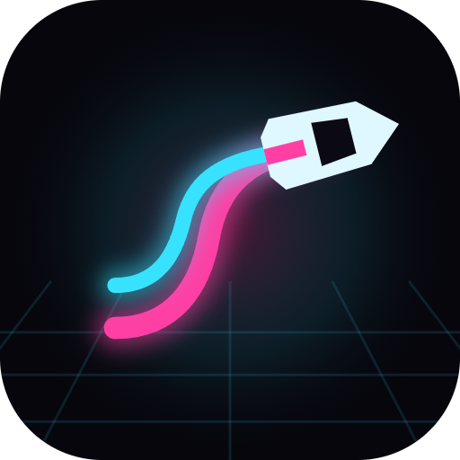

# Neon Drift



Neon Drift v1.0 is a portrait-first arcade drifting game for desktop browsers, mobile browsers, and Android.
The car accelerates automatically: hold to turn into a bend, then release to straighten. Chain clean drifts,
near misses, and pickups to build your score and unlock cosmetic cars.

The browser game and Android APK share the same TypeScript simulation and Phaser renderer. Progress stays on
your device. There are no accounts, ads, analytics, purchases, or online leaderboards.

## Run locally

The verified development environment uses **Node.js 22.13.1** and **npm 10.9.2**. Install Node and npm first,
then run these commands from the repository root:

```sh
npm ci
npm run dev
```

Open **[http://localhost:5615/](http://localhost:5615/)**. Keep the terminal running; press **Ctrl+C** to stop it.
`npm start` starts the same development server. No `.env` file, API keys, database, or backend setup is needed.
The initial dependency installation requires internet access.

On this Windows workspace, enter the repository with:

```powershell
Set-Location "E:/New repos for portfolio/NeonDrift"
```

The port is fixed and strict. If port 5615 is occupied, stop the other Neon Drift server before starting another,
or explicitly choose a different development port:

```sh
node node_modules/vite/bin/vite.js --port 5616
```

### Preview the production build

Stop the development server first, since preview uses the same port.

```sh
npm run build
npm run preview
```

The build validates all 60 stages, checks TypeScript, and writes the web bundle to `dist/`. Serve those files
with a static HTTP server; opening `dist/index.html` directly with `file://` is not the supported launch path.
Asset paths are relative, so the bundle can also be hosted under a subdirectory.

The game can continue playing without a network connection once the web page has loaded. A fresh offline
browser launch is not guaranteed: this repository does not currently include a service worker or PWA installer.
The Android APK bundles its assets for offline launch.

## How to play

1. Choose **Play** on the main menu, or **Let's go** in the first-launch welcome dialog.
2. Hold the playfield just before a corner. The game selects the bend direction when the press begins and
   keeps that direction until you release. Release between changes of direction.
3. Let go as the bend opens to straighten the car. Holding continuously can spin the car out.
4. Build score through clean drifts, close passes, sparks, and traffic overtakes. Three clean maneuvers
   increase the combo multiplier, up to **x8**. Scrapes and impacts break the combo; inactivity lets it decay.
5. Reach the finish **and** meet the stage objective to earn one star. Higher score thresholds award two or
   three stars. Clear a stage to unlock the next one.

### Controls

| Action | Touch / mouse | Keyboard |
|---|---|---|
| Assisted drift | Hold the playfield; release to straighten | Hold Space, W, or Up Arrow |
| Steer left / right | Select **Left / right** in Settings to show buttons | A / D or Left / Right Arrow |
| Earned boost | Tap the Boost button when charged | Shift, B, or Down Arrow |
| Pause / resume | Pause button, then Resume | Esc or P |
| Restart the current attempt | Restart in the pause menu, or Retry after a crash | R |
| Mute / unmute | Sound control or Settings | M |

Keyboard driving shortcuts apply while the playfield has focus, rather than while you are interacting with
a menu control or dialog. Android Back pauses an active run, resumes a paused run, or navigates back from a menu.

### Pickups and hazards

| Item | What it does |
|---|---|
| Spark | Adds score and helps charge boost |
| Shield | Absorbs one damaging impact and grants a short grace period |
| Magnet | Pulls nearby sparks toward the car for six seconds |
| Cone / block | Causes a crash unless protected; a close pass can earn a near miss |
| Sliding gate | Moves across the road on a fixed rhythm |
| Traffic | Slower cars; blinkers signal an approaching lane change |

Boost is earned through play. Car appearances and palettes change the visuals only; every car uses the same
handling and collision geometry.

## Modes, progression, and menus

There are **60 authored stages**, arranged into six districts of ten stages:

| District | Main pattern |
|---|---|
| Electric Alley | Hold, release, and the first drifts |
| Rainline Docks | Long sweepers and S-bends; rain is a visual theme |
| Sunset Circuit | Tight corners and hairpins |
| Metro Pulse | Traffic and signaled lane changes |
| Skyline Switchbacks | Chained bends and sliding gates |
| Midnight Grand Prix | Combined patterns at higher speeds |

Objectives include finishing, drift points, a target multiplier, sparks, passing traffic, and a target time.
Completing Electric Alley unlocks **Endless** and the **Daily** challenge. Endless increases speed and difficulty
with distance. Daily courses are deterministic from the device's local calendar date and a validated seed pool;
they do not use a server.

- **Stages:** district selection, individual objectives, star targets, best scores, and completion times.
- **Garage:** eight car appearances and six palettes, unlocked through stars and district completion.
- **Trophies:** achievement progress.
- **Boards:** local top-ten endless/daily scores, personal bests, and lifetime statistics.
- **Settings:** control scheme, sensitivity, audio volumes, mute, haptics, effects quality, screen shake,
  reduced motion, and interface size.
- **How to play / About:** controls, hazard legend, credits, and privacy details.

## Saves and accessibility

Progress and settings save automatically in local storage, with versioned data and a rolling backup.
If storage is blocked, the game still plays, but progress cannot persist. Browser origins have separate saves:
`localhost:5615`, `localhost:5616`, a hosted site, and the Android app do not automatically share progress.

Use **Settings → Your data → Export** to copy your progress as text. On another installation, use **Import**
to paste it back. Import replaces the progress on that installation. The export contains progression and
cosmetic selections; it does not include audio, display, or control settings. Reset erases local progression.

For easier play, try the alternate steering buttons, adjust sensitivity, increase interface size, turn off
screen shake, or select Reduced motion. Audio has separate music and effects sliders. Sound starts after a
user gesture, and haptics depend on device support.

## Build Android

Android builds require **JDK 21 or newer**, an Android SDK with **platform 36**, SDK build-tools, and platform-tools.
Set `ANDROID_HOME` to your SDK directory. Set `JAVA_HOME` to a compatible JDK if the build script cannot discover it.
The repository includes the **Gradle 8.14.3 wrapper**; a separate global Gradle installation is unnecessary.
The first native build may download Gradle and Android dependencies.

```sh
npm run android:apk
npm run verify:artifacts
```

The APK command builds the web app, syncs Capacitor, runs Gradle, checks package metadata and signing,
and copies the actual debug artifact to:

```text
dist/android/neon-drift-v1.0-debug.apk
dist/android/neon-drift-v1.0-debug.apk.sha256
dist/android/artifact-manifest.json
```

The application ID is `com.portfolio.neondrift`, minimum SDK is **24**, and target SDK is **36**.
The APK is debug-signed. There is no release signing or store publishing configured.
Its manifest does not request internet access; haptics add the vibration permission.

To install on a connected test device, with `adb` available on your PATH:

```sh
adb devices -l
adb -s YOUR_DEVICE_SERIAL install -r "dist/android/neon-drift-v1.0-debug.apk"
```

`npm run android:sync` builds and copies web assets into the native project without producing an APK.
`npm run android:icons` regenerates the launcher/splash artwork using an installed Edge or Chrome browser.
A later `npm run build` recreates `dist/` and removes any APK stored there; rerun `npm run android:apk` to restore it.

## Development checks

| Command | Purpose |
|---|---|
| `npm run typecheck` | Strict TypeScript checks |
| `npm run lint` | ESLint and configured complexity rules |
| `npm test` | Unit and integration tests |
| `npm run test:coverage` | Coverage report in `coverage/`; 90% thresholds across four metrics |
| `npm run levels:check` | All-stage geometry, uniqueness, calibration, and objective replay checks |
| `npm run levels:report` | Refresh the generated level table inside `ARCHITECTURE.md` |
| `npm run test:e2e` | Real-browser checks against the running development server |
| `npm run android:verify` | Device QA against the APK; requires an explicitly selected test device |
| `npm run verify:artifacts` | Check the existing web bundle, APK, metadata, and checksum |

Browser tests use installed Edge, then Chrome, through `playwright-core`; no bundled browser is downloaded.
They use isolated test storage. Optional environment variables include `NEON_URL`, `NEON_BROWSER`, and
`NEON_GREP`. Android test setup, maintenance commands, and the known test-runner limitations are documented in
[Architecture → Verification and release status](ARCHITECTURE.md#verification-and-release-status).

## Architecture and release status

Read **[ARCHITECTURE.md](ARCHITECTURE.md)** for the module map, design decisions, startup sequence, simulation,
collision/scoring flow, save lifecycle, level authoring, Android packaging, flowcharts, and the 60-stage report.
These are the two maintained Markdown documents; related technical and validation notes live in that guide.

The November 5, 2026 audit verified the web build, 208 unit tests, all 60 stage replays, and a debug APK build
and emulator installation. Full Android lifecycle/offline QA, physical-device performance testing, and human
playtesting remain incomplete. The architecture guide records those limits and the outstanding runner issues.

All car/scenery artwork is drawn in code and sounds are synthesized. Phaser and Capacitor use MIT licenses;
the locally bundled Manrope and Unbounded fonts use SIL Open Font License 1.1. Third-party package license
files remain in their packages. This repository does not currently declare a license for its own game code.
